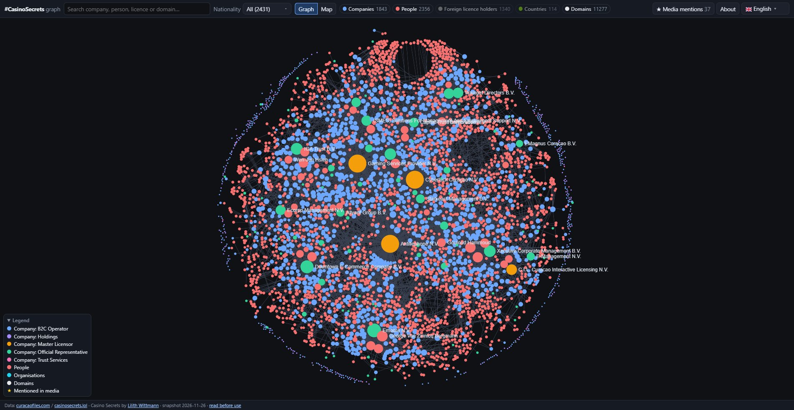
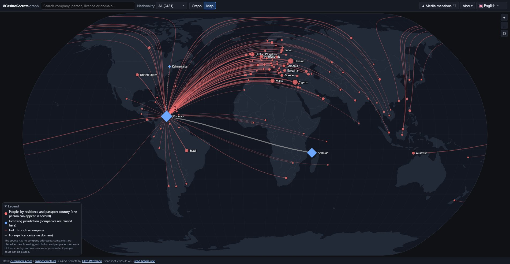

# curacaofiles_graphics

An interactive relationship graph of the public **Casino Secrets** register data published at [curacaofiles.com](https://curacaofiles.com/) (mirror: [casinosecrets.lol](https://casinosecrets.lol/)).

The source site lets you search companies and domains one page at a time. This project puts the same records into a single network so that links between them become visible: one person who appears in three companies is **one node** connected to all three, a company is connected to its local representative and master licensor, and companies that list the same casino domain are connected to each other.

**Live site: [curacaofiles-graphics.github.io/curacaofiles_graphics](https://curacaofiles-graphics.github.io/curacaofiles_graphics/)**





> **Read before use.** The inclusion of a person, company, domain, or other entity in the Casino Secrets database does not imply illegal or improper conduct. Records may be incomplete, outdated, or contain errors from the underlying source systems. Verify identities before drawing conclusions. All credit for the investigation and the data goes to [Casino Secrets](https://www.lilithwittmann.de/series/casinosecrets/) and its partners.

## Features

- Search by company, person, licence number or domain; filter node types.
- Side panel for every node, with links back to the source page (main site and mirror), every document's open / download link on the source site, licensing process, domains, roles (as badges) and the other people of each company.
- **Country filter**: one or several countries, most common first, with counts and SVG flags. Each country is shown under its own name and the register's English name (for example "Deutschland (Germany)") and can be searched by either, or by its name in the interface language. Matches passport countries, residence countries and name-based hints by default; the last two can be switched off. The graph then shows only those people and what they connect to, laid out on their own so related nodes sit together.
- **Map view** (the "Map" switch next to the search box): people on a world map at their residence and passport countries, linked to the licensing jurisdiction of their companies (Curaçao, or Anjouan / Kahnawà:ke for foreign licence holders). Select a person, company or country to see only its network. The source has no company addresses, so positions are approximate. The graph stays the default view.
- **Media mentions** (optional): curated notes on what a video or article says about records, with a timestamped link. They are shown as third-party claims. See [docs/adding-media-mentions.md](docs/adding-media-mentions.md) to add one.
- **Link notices**: betting and casino domains are shown as plain text, not links. Clicking one opens a disclaimer, and the site can only be opened from there after a 5-second wait, every time. Video links first show a short notice that the video may be blocked in some countries (another network or a VPN may help).
- 28 interface languages (English by default), RTL for Arabic and Hebrew. The register's fixed vocabulary (roles such as "Managing Director", entity groups, company types, domain statuses) is translated, with the original as a tooltip; names, free text and claims are not. A legend in the bottom-left corner explains colours and shapes. The selected node, filters and language are kept in the URL, so a view can be shared.

## What is in the graph

| Node | Comes from |
| --- | --- |
| Company | every entity on `/casinos/` and its own page (operators, holdings, master licensors, representatives, trust services) |
| Person | "Related Entities" on company pages (beneficial owners, directors, compliance officers, …) |
| Organisation | related entities without a page of their own |
| Foreign licence holder | `/other-jurisdictions` (Anjouan, Kahnawà:ke registers) and "Also recorded for" domain notes |
| Country | passport and residence countries of people |
| Domain | a company's licensed domains, added to the graph on demand from the side panel |

| Edge | Meaning |
| --- | --- |
| `role` | person / organisation holds a role in a company |
| `representative`, `master_licensor`, `related` | company-to-company links listed on the pages |
| `shared_domain` | two companies list the same domain |
| `foreign_licence` | a foreign licence holder lists a domain that a Curaçao company also lists |
| `passport`, `residence` | person to country |

**People.** The source has no person ids. Records are merged into one person when the normalised name and the birth month match; filings that differ by a month (or a one-letter spelling) but share the name, birth year and a passport or residence country are merged too, and keep every birth month seen. Same-name records with other details stay separate and are shown as possible matches.

**Name-based country hints** are only hints, marked as guesses, and can be switched off in the country filter. They combine statistics learned from the passport data itself, per-country naming patterns (`scraper/src/curacao_scraper/name_profiles.py`) and per-country name lists generated from [Faker](https://github.com/joke2k/faker)'s dummy-data providers (MIT, `scraper/tools/build_name_lists.py`).

Nothing is copied from the documents. Each record keeps links to its source page, and every document keeps its original link on the source site.

**Domains.** The register lists a domain once per status period when it was deleted and added again. The scraper keeps one entry per domain with its current status and lists the earlier periods under it.

## In the press

Reporting on the Casino Secrets investigation by third parties, including the stories listed on [curacaofiles.com](https://curacaofiles.com/) (also in the site's About box).

Articles:

- [Curaçao's secretive gambling industry exposed in leak](https://www.ftm.eu/articles/curacao-secretive-gambling-industry-exposed-in-leak) · Follow the Money · 2026-09-22 · EN
- [Gamblinglekkasje: Ett av sporene leder NRK til norsk mangemillionær](https://www.nrk.no/trondelag/xl/lekkasje-fra-curacao_-soknader-om-lisens-avslorer-nordmenn-1.17979635) · NRK · 2026-09-22 · NB
- [Casinolizenzen aus Curaçao](https://www.lilithwittmann.de/blog/casino-secrets-cga/) · Lilith Wittmann · 2026-09-22 · DE
- [Wem gehört das Platincasino?](https://www.lilithwittmann.de/blog/casino-secrets-platincasino/) · Lilith Wittmann · 2026-09-22 · DE
- [Softswiss - Milliardenbusiness in Berlin](https://www.lilithwittmann.de/blog/casino-secrets-softswiss/) · Lilith Wittmann · 2026-09-22 · DE
- [Casino-Secrets: Diese Österreicher stecken hinter dem illegalen Online-Glücksspiel](https://www.jetzt.at/artikel/sA1psVwJ-aiM8QAs4-9cbbc) · JETZT · 2026-09-22 · DE
- [Curaçao Hacker Threatens to Expose Owners Behind Hundreds of Offshore Casinos](https://www.casino.org/news/hacker-behind-massive-curacao-leak-could-expose-who-really-owns-hundreds-of-offshore-online-casinos/) · Casino.org · 2026-09-22 · EN
- [Virginia anunciou rompimento um dia após Blaze entregar contrato de R$ 100 milhões à Justiça](https://c-level.folha.uol.com.br/negocios/2026/09/virginia-rompeu-com-blaze-um-dia-apos-bet-entregar-contrato-publicitario-de-r-100-milhoes-a-justica.shtml) · C-Level (Folha) · 2026-09-23 · PT
- [Hacked MGA Files Point To Malta In Germany's Biggest Illegal Casino Case](https://lovinmalta.com/news/hacked-mga-files-point-to-malta-in-germanys-biggest-illegal-casino-case/) · Lovin Malta · 2026-09-23 · EN
- [Curaçao and Its iGaming Sector Once Again Under International Scrutiny](https://www.curacaochronicle.com/post/unknown/curacao-and-its-igaming-sector-once-again-under-international-scrutiny) · Curaçao Chronicle · 2026-09-23 · EN
- [MGA-Licensed Operator Linked To €5.86 Billion German Illegal Gambling Probe](https://www.amphora.media/2026/09/mga-licensed-operator-linked-to-e5-86-billion-german-illegal-gambling-probe) · Amphora Media · 2026-09-24 · EN
- [Norsk milliardær er deleier av kasino-selskap på Curaçao](https://www.nrk.no/trondelag/morten-klein-er-storste-personlige-aksjonaer-i-comeon-curacao-1.18035511) · NRK · 2026-09-25 · NB
- [Malta firms tied to 'illegal' German gambling after hacked MGA documents exposed](https://timesofmalta.com/article/malta-firms-tied-illegal-german-gambling-hacked-mga-documents-exposed.1134633) · Times of Malta · 2026-09-25 · EN
- [Private Ryan](https://josimarfootball.com/2026/09/25/private-ryan/) · Josimar · 2026-09-25 · EN
- [Vast Casino Secrets leak exposes inner workings of offshore gambling firms](https://www.theguardian.com/society/2026/sep/26/casino-secrets-leak-offshore-gambling-firms-curacao-regulator) · The Guardian · 2026-09-26 · EN
- [«Casino Secrets»: Τεράστια διαρροή αποκαλύπτει τα μυστικά των offshore online καζίνο](https://www.politis.com.cy/politis-news/kosmos/1036793/casino-secrets-terastia-diarroi-apokalyptei-ta-mistika-ton-offshore-online-kazino) · Politis · 2026-09-26 · EL
- [“Casino Secrets”, investigimi gjigand që tronditi botën e basteve online: zbulohen pronarët dhe financat e mijëra kazinove offshore](https://vna.al/casino-secrets-investigimi-gjigand-qe-tronditi-boten-e-basteve-online-zbulohen-pronaret-dhe-financat-e-mijera-kazinove-offshore-i29498) · VNA · 2026-09-26 · SQ
- [Casino Secrets leak exposes gaps behind Curaçao casino licences](https://www.casino.com/news/industry/casino-secrets-leak-exposes-gaps-behind-curacao-casino-licences/) · Casino.com · 2026-09-28 · EN
- [“Casino Secrets” Offers Insight into the Structures of Illegal Online Casinos](https://www.isa-guide.de/english-news/casino-secrets-offers-insight-into-the-structures-of-illegal-online-casinos/) · ISA-GUIDE · 2026-09-30 · EN
- [Former federal minister De-Anne Kelly revealed as co-founder of offshore casino](https://www.abc.net.au/news/2026-10-02/former-minister-de-anne-kelly-co-founded-offshore-casino/107197106) · ABC News (Australia) · 2026-10-01 · EN
- [Before the Verdict: Leaked Files and Film Edits in Europe's iGaming Investigations](https://eutoday.net/before-the-verdict-leaked-files-and-film-edits-in-europes-igaming-investigations/) · EU Today · 2026-11-03 · EN
- [Kansspelautoriteit Curaçao gehackt: land blijkt het niet zo nauw te nemen met verstrekken van vergunningen voor online gokken](https://www.volkskrant.nl/economie/kansspelautoriteit-curacao-gehackt-land-blijkt-het-niet-zo-nauw-te-nemen-met-verstrekken-van-vergunningen-voor-online-gokken~b9ff43bb/) · de Volkskrant · NL

Videos (some may be blocked in certain countries; another network or a VPN may help):

- [Casinos Secrets: Wer casht ab mit illegalen Casinos?](https://www.youtube.com/watch?v=QIU0oeGzVJ0) · STRG_F (NDR / funk) · 2026-09-22 · DE
- [DEV SIZINTI - ABLA HERKESİ PATLATTI](https://www.youtube.com/watch?v=ydvRvIsYhsc) · Cevheri Güven · 2026-09-27 · TR
- [Platincasino offline | #casinosecrets](https://www.youtube.com/watch?v=3TLPJHWCros) · Lilith Wittmann · 2026-10-03 · DE
- [Glücksspiel-Spuren führen von Curacao nach Österreich](https://on.orf.at/video/14342038/16165975/gluecksspiel-spuren-fuehren-von-curacao-nach-oesterreich) · ORF ZIB 2 · 2026-10-06 · DE
- [The Island Behind the Online Casino Epidemic](https://www.youtube.com/watch?v=dKM7ly_YdEk) · TerraScope · 2026-10-09 · EN
- [퀴라소 카지노 서류 4만 건 유출…스테이크 등 역외 업체 실소유주 의혹 폭로](https://www.youtube.com/watch?v=qF-5QuKxWFM) · 카지노친구 · 2026-10-20 · KO
- [How Stake Became a $2.6 Billion Casino Without a Single Building](https://www.youtube.com/watch?v=y2WrVjAtOmM) · Professor Frontman · 2026-10-28 · EN
- [Hackerin: So hat sie den Millionenbetrug illegaler Casinos aufgedeckt](https://www.youtube.com/watch?v=kdXcpgp8Oos) · Finanzfluss · 2026-11-05 · DE
- [ILLEGAL CASINOS INVESTIGATION](https://www.youtube.com/watch?v=1EtBnmCY178) · Business-Story · 2026-11-06 · DE
- [€5.86 Billion in Bets: Who Owns Germany's 'Illegal' Casino?](https://www.youtube.com/watch?v=AynsioDt6EY) · FinancialPsychology · 2026-11-14 · EN

## Layout

```text
scraper/             Python: crawls the site politely and writes one JSON file
web/                 Vite + React + TypeScript + Sigma.js: the graph and map viewer; web/public/data/ holds the data and the media mentions
docs/                guides (adding media mentions)
.github/workflows/   GitHub Pages build and deploy
```

## Usage

### 1. Build the data

Python 3.11+.

```sh
cd scraper
pip install -e .             # or: uv sync
curacao-scraper              # crawl + build
```

- `crawl` downloads `/casinos/`, `/other-jurisdictions` and every company page into `scraper/.cache/html/`, one request at a time with a pause between requests (`--delay`, default 1.5 s). Cached pages are not downloaded again, so an interrupted crawl continues where it stopped. `--mirror` uses casinosecrets.lol, `--refresh` downloads everything again, `--limit N` takes only the first N company pages.
- `build` parses the cached pages into `web/public/data/graph.json` and adds the media mentions from `web/public/data/highlights/` (one JSON file and transcript per video or article) (`--highlights DIR` for another folder; see [docs/adding-media-mentions.md](docs/adding-media-mentions.md)). Each company's documents and licensing process go into a separate file, `web/public/data/companies/<company id>.json`, which the viewer loads only when that company is opened. This keeps `graph.json` small (about 7.5 MB, under 1 MB compressed).

Tests use synthetic pages only: `python -m pytest`.

### 2. Run the viewer

Node 22.12+ and pnpm.

```sh
cd web
pnpm install
pnpm run layout              # precompute node positions into graph.json
pnpm run centroids           # only after updating world-atlas: country points for the map (src/map/centroids.json)
pnpm run dev                 # development server
pnpm test                    # unit tests (Vitest, web/tests/)
pnpm run build               # static site in web/dist/ (includes data/)
```

### Adding a language

Interface strings live in `web/src/locales/`, one file per language. Copy `en.ts` to `<code>.ts`, translate the values (keep `{n}`-style placeholders as they are) and add a line to `LANGUAGES` in `locales/index.ts`, keeping the list alphabetical by language code. TypeScript and `pnpm test` fail if a key or a placeholder is missing.

## Deploy (GitHub Pages)

`.github/workflows/pages.yml` runs the tests, builds the site and deploys `web/dist` to GitHub Pages. It deploys the data committed in `web/public/data/` and does not crawl the source. To crawl again (for example if the source publishes new records), run the workflow by hand with the `crawl` option (`refresh` downloads every page again instead of reusing the cached ones). Enable Pages with "GitHub Actions" as the source in the repository settings.

## License

Code: [MIT](LICENSE). Flags: [flag-icons](https://github.com/lipis/flag-icons) (MIT). Map shapes: [world-atlas](https://github.com/topojson/world-atlas) / Natural Earth (ISC, public domain). The data belongs to its publishers; check the source site before republishing it.
